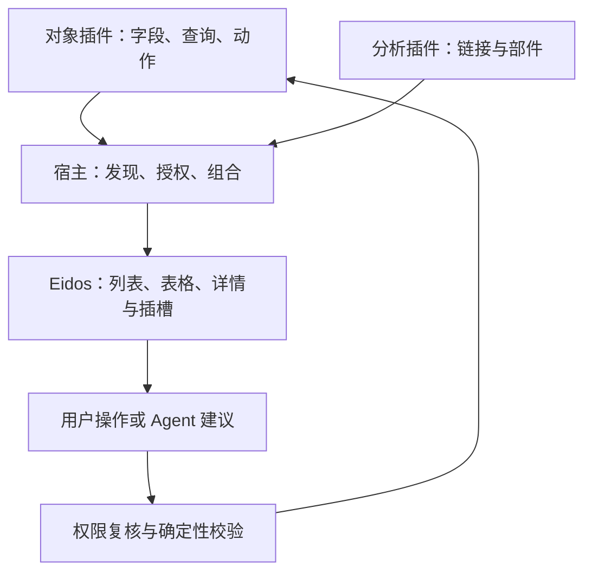

# 基础对象与列表类应用：通用体验、LLM 快捷功能与插件扩展计划

日期：2026-10-12（香港）  
状态：PROPOSED / 待评审，不替代现有架构权威。  
适用：Counterparty、Item、Warehouse，以及以后需要列表/详情/导入的业务插件。  
仓库基线：EVO-App-Platform main `ccb5820b99d854e1e78f6c35bfb77e01e7d084f1`。来源编号见 [REFERENCES.md](REFERENCES.md)。

> 范围补充：本文件是基础对象与列表的首个实施切片。销售/采购单据、出库/调拨执行、报销/请假申请、审批以及完整手机端要求，统一见 [企业业务应用通用体验框架](BUSINESS-EXPERIENCE-FRAMEWORK.md)。不要仅凭本文件认定所有业务应用已覆盖。

## 1. 目标与不变的边界

目标不是增加几个孤立按钮，而是让新插件声明业务字段、查询、动作和页面贡献后，能够复用成熟的列表应用体验。行业做法用于参考，具体规范以下文的 EVO 建议为准。

用户本轮明确要求：完善基础对象及相关列表应用；包含列表、表格、操作按钮、页面布局；加入 LLM 快捷功能，尤其智能识别导入字段；为未来 BI 保留页面链接和页内插件两条路径。本次先交付计划，不扩大为立即开发 BI 或重写基础对象。

沿用现有设计：一个对象权威，多种角色/关系面、多种投影和导入渠道。往来对象不等于所有人员/机构；仓库定义位置，不拥有库存数量；运行时财务事实不进入主数据；“我的供应商”由职责与权限共同确定，不是复制一套供应商表。[R01–R05]

统一体验也不意味着统一所有对象的业务规则。字段校验、归档限制、重复处理、引用关系由对象所属插件定义。Eidos 决定通用交互和视觉；平台仅负责插件发现、生命周期、权限和组合。

## 2. 现状、可复用项和明确缺口

| 领域 | 已查代码或文档证据 | 本计划处理 |
|---|---|---|
| 对象体系 | descriptor 声明 owner、字段扩展槽、操作、导入目标和投影来源 | 继承，不新造对象框架 |
| 有效字段 | Schema 已含字段含义、多语言、只读、适用条件、目标资源、LIST/FILTER/IMPORT 等 surface | 列、筛选、导入和 AI 共用此语义基础 |
| 对象页面 | Counterparty 等使用 Eidos catalog-browser 列表，已有新建/导入/详情入口 | 统一页面结构，保持旧路由可用 |
| 数据表格 | 当前 catalog-browser 无完整列、远程数据源和编辑契约；其 grid 表示卡片 | 在 Eidos 增加/核对真正的数据表格能力 |
| 导入 | CSV/XLSX、字段映射、校验、目标适配器、Recipe 已存在 | 改善任务体验与缺口，不重做导入引擎 |
| AI 入口 | `ai-auto-map` 已带 jobId/targetId/taskKind 并请求完成刷新 | 补状态、差异审核和失败恢复，复用入口 |
| Recipe | 企业资源中保存，含结构指纹、schema digest、人类确认和校验证据 | 继承失效判断，严禁仅凭文件名复用 |
| 个人工作台 | 按授权贡献叠加企业角色默认与个人偏好 | 用作工作入口，不冒充完整 BI 引擎 |
| 扩展插槽 | 现有 descriptor 的 extensionSlots 是对象字段槽 | 不把字段槽误当页面插件插槽；需单独设计 |
| 多语言 | 字段契约支持多语言；部分 page.ts 当前只区分中文/英文 | 新组件按四语契约建设，补翻译列入独立任务 |

状态冲突需保留：当前 handoff 标记 TR-01；foundation-map 仍有 WH01_ACTIVE，而基础对象路线图已注明 WH-01 CLOSED_PRODUCTION_PASS。本轮不更新全局进度或重复做仓库业务验收；实施前以主线负责人当前验收记录对账。[R01]

## 3. 行业模式如何落入 EVO

SAP 的 List Report + Object Page 提供列表到对象详情的组织参考，但本轮 SAP 原页面抓取未取得正文，仅检索摘要可用，不据此宣称某个最新控件能力。[S01]

Power Apps 的统一网格允许配置只读/编辑、分组及聚合，也可按宽度变成列表。借鉴“同一数据契约、多种呈现”，不直接搬其全部功能与限制。[S02]

Microsoft 导入和 Copilot 资料分别支持“映射、复核、复用”和“AI 建议字段元数据后人工检查”的方向。[S03–S04] 本项目的 schema/Recipe 优先于模型推断。

AG Grid 服务端分页说明了大数据应按查询获取，而不是一次全部装入浏览器；这里只借鉴数据接口，不决定采购或引入该库。[S05]

WAI-ARIA 区分真正的交互网格与普通表格；数据表格若提供键盘编辑，需要完整焦点管理，不能只加 grid 角色。[S06]

## 4. 页面家族：一套对象，多种工作入口

| 页面 | 用途 | 默认内容 | 不应承担 |
|---|---|---|---|
| 对象目录 | 管理员维护全企业授权范围内的主数据 | 搜索、视图、筛选、数据区、导入/新建 | 作为每名员工唯一首页 |
| 角色工作列表 | 我的供应商、我的客户、我负责的仓库 | 职责范围内记录与任务动作 | 自己定义另一套对象身份 |
| 对象详情 | 理解一个对象及其关联 | 身份摘要、基本资料、关系/扩展面、历史 | 默认展示所有可能字段 |
| 创建/编辑 | 维护少量对象 | 最小必填、适用字段、明确保存 | 把几十项可选字段全部平铺 |
| 对象选择器 | 在业务单据中引用对象 | 搜索、关键识别列、单/多选 | 搬整个管理页进弹窗 |
| 导入工作区 | 批量初始化/维护 | 文件、匹配、校验、确认、结果 | 直接写入而无可见校验 |
| 导入历史 | 查作业进度、错误与来源 | 时间、对象、发起人、状态、数量、详情 | 混淆新建导入与历史记录 |
| 分析页面 | 独立 BI 深度探索 | 指标、图表、钻取及来源口径 | 修改基础对象业务真相 |

“列表页”是页面类型，“数据表格”是该页的数据呈现方式，两者不是互斥页面。列表/表格切换共用查询、筛选、权限、选中对象和返回状态。

仓库有天然层级时后续增加树表；不能因仓库而让所有基础对象默认树结构。

## 5. 列表工作页固定布局

| 自上而下区域 | 内容与规则 | 插件可扩展范围 |
|---|---|---|
| 导航区 | 面包屑：工作台 / 基础对象 / 当前视图；返回保留原查询 | 声明父路由，不插入自制导航 HTML |
| 页头 | 名称、用途、当前企业；一个明确主要动作 | 对象插件声明标题与主要动作 |
| 视图区 | 当前视图、另存视图；必要的“全部/客户/供应商”等视图入口 | 可贡献命名视图，不任意增加无关页签 |
| 查询区 | 搜索、常用筛选、已选条件标签、清除、更多筛选 | 只从可查询且有权的字段生成 |
| 可选摘要区 | 可折叠的少量统计；首屏默认无未安装 BI 空框 | `list.summary` 插槽，按需加载 |
| 集合工具栏 | 列设置、密度、列表/表格切换、刷新、导出、分析 | `list.relatedLinks`；高级操作进入更多菜单 |
| 选择操作栏 | 选中 N 项后出现，可用的批量动作与取消选择 | 声明支持批量的业务动作 |
| 主数据区 | 表格或紧凑列表；空/载入/错误/无权限状态 | Eidos 统一数据呈现，不注入任意 DOM |
| 页尾 | 分页、加载数量、更新状态 | 不放无关业务按钮 |
| 按需侧区 | 详情预览或 Agent 任务，一个时刻只开启一个主侧区 | `list.assist`，移动端独立页面 |

首期导入型管理员目录将“导入”作为主要动作，“新建”作次要动作；日常工作列表可将新建或领域主要操作设为主按钮。由页面任务决定，不因有 AI 就把 AI 按钮设为全站主要动作。

页头固定的是职责层级，不是每个区域必须可见。未装分析插件时不留巨大空白，不显示永远不可点的“BI 即将推出”。

### 5.1 表格默认规范

- 第一列选择框（支持批量时），第二列对象名称/主标识可打开详情；编码可相邻显示。状态和关键关系优先，默认建议 6–8 个业务列。
- 列序、宽度、可见性和密度为个人展示偏好；服务端字段权限仍先过滤。敏感字段不得通过“显示所有列”恢复。
- 列类型至少覆盖文本、标识码、枚举、日期、布尔、数字、引用；金额/单位扩展必须声明币种/计量单位，不能随意汇总不同单位。
- 长文本截断但可通过聚焦/展开查看全文；不依赖悬停才能读关键内容。空值、零值、无权限有不同语义。
- 点击名称进入详情；点击选择框不导航；复制操作不触发行跳转。编码提供 Eidos 复制按钮，成功后短暂显示“已复制”，失败给出可操作提示。
- 排序必须稳定，最后追加对象 ID；多列排序显示优先级。服务器不支持的排序/筛选项不得假装生效。
- 首期只读表格 + 显式编辑页。行内编辑放后续，仅限对象 owner 明确支持的简单字段；关系角色、金额规则、状态迁移不默认开放单元格修改。
- 分页建议默认 50，允许 25/50/100，服务端上限建议 200；这些是初始产品参数，需性能验证后调整。
- 支持当前页多选；跨页“选择所有匹配项”后续需服务器查询快照/范围令牌，不能把当前已加载数据冒充全部数据。
- CSV/Excel 导出区分“选中项”和“当前筛选结果”，重新检查导出权限及字段范围，大导出异步；电子表格公式注入处理在导出层完成。

### 5.2 列表、窄屏与无障碍

桌面高密度维护默认表格；窄屏默认紧凑列表，每条记录保留名称、编码、状态及 2–3 项关键事实。支持主动选择呈现方式；不能让手机默认横向拖动十几列。

普通只读表格优先原生 table 语义；若升级成交互 grid，统一实现 Tab 进入/退出、方向键导航、Enter/F2 编辑、Escape 取消、焦点恢复和读屏信息。[S06] 表头排序有文字状态，错误不只用颜色。移动端触摸目标和排版沿用 Eidos token，不在各插件硬编码尺寸。

筛选在窄屏使用抽屉/独立面板；选中时显示批量条；关键按钮保留文字，图标从 Eidos 图标库取。所有悬停动作同时支持键盘焦点和触摸入口。

## 6. 对象详情、编辑和选择器

详情页头显示名称、编码、状态、关系角色和主要动作。内容按业务面分段：基本资料、适用关系、联系人/地址、企业扩展、关联记录、历史来源。只显示已安装、适用且有权访问的面；复杂维护可打开独立页面。

右侧可选摘要/洞察区；下方可选扩展页签。分析无权限或失败不阻断基本资料读取。复制编码与复制页面链接分开，复制链接不携带凭据或敏感筛选值。

编辑页：身份必填在前，条件字段按角色/对象类型展开；必填、格式、只读规则取有效 Schema；提交前确定性校验，错误定位字段并保留输入。并发写入用 revision/ETag 等版本比较；冲突展示服务器值与本次修改，不后写覆盖前写。具体版本字段以 owner 现有契约为准，缺少时在该 owner 补齐。

返回列表恢复 viewId、筛选、排序、页位置和焦点。若记录已不符合筛选，解释“已保存，但不在当前视图中”。业务记录被其他单据引用时，归档/删除由 owner 拒绝或给出明确路径。

选择器复用同一字段目录与授权查询，只返回稳定对象引用；禁止把自由输入的显示名称当已验证对象 ID。

## 7. 操作按钮与状态协议

| 范围 | 例子 | 放置 | 交互要求 |
|---|---|---|---|
| 页面 | 导入、新建 | 页头 | 明确任务入口，通常一个主按钮 |
| 集合 | 筛选、列设置、导出、分析 | 集合工具栏 | 作用于当前查询，显示范围 |
| 多选 | 批量分配、归档 | 选中操作栏 | 支持项交集；逐项权限检查；变更前预览 |
| 单条 | 查看、编辑、复制编码 | 行内/更多菜单 | 常用动作不超过少量，其余收纳 |
| 表单 | 保存、取消 | 一致的表单操作区 | 保存中防重复；失败保留草稿 |
| AI | 自动匹配、生成筛选、解释错误 | 相应任务附近 | 绑定具体任务，不要求用户重新描述上下文 |

不可用分三类：无权或未装→不输出该能力；有权但条件未满足→禁用并解释；服务暂不可用→保留重试路径。写入按钮不能仅在前端禁用，服务端仍重新授权。

载入只影响当前数据区；空目录提供导入/新建；筛选无结果提供清除筛选；无权限明确告知；连接失败可重试；结果过期显示刷新入口。AI 运行状态独立于数据加载，“正在思考”只在模型请求期间出现。

## 8. LLM 快捷能力：分工、优先级与审核

| 功能 | 确定性部分 | LLM 辅助 | 人类确认点 | 批次 |
|---|---|---|---|---|
| 智能字段匹配 | Schema/Recipe、类型检查、别名、必填检查 | 同义字段与样本语义候选 | 歧义映射、扩展字段、正式提交 | 1 |
| 自然语言筛选 | 白名单查询 AST、授权、排序分页 | 将“缺联系人供应商”转条件草稿 | 展示可读条件后应用 | 2 |
| 导入错误解释 | 行号、错误码、字段规则 | 合并相似错误并给修正建议 | 更改数据后再校验 | 1/2 |
| 字段补全/标准化 | 格式与规则归一化 | 从已授权资料提取候选 | 原值/新值差异确认 | 后续 |
| 重复对象提示 | 精确键与引用检查 | 模糊名称相似度解释 | 合并由独立业务流程确认 | 后续 |
| 分析说明 | 指标查询和计算 | 解释已返回指标、提出跟进问题 | 任何业务写入另走审核 | 3 |

不让 LLM 负责分页、金额汇总、最终权限、必填判断、持久化事务或生成可直接执行的 SQL/JavaScript。模型输出只是结构化建议，服务端按白名单字段、操作符和动作验证。

### 8.1 字段识别完整流程

1. 上传后由解析器识别工作表、表头、类型分布和异常；数据量、样本范围、隐私规则先确定。
2. 先匹配有效 Recipe，再做编码/字段 ID/受管别名等确定性匹配；仅把剩余歧义交给模型。
3. 传模型的数据为授权目标 Schema、字段业务含义、枚举、表头及少量脱敏样本。不得默认上传整表、隐藏字段或其他企业资料；文件内文字按数据处理，不能变成工具指令。
4. 候选结果包含 sourceColumn、targetFieldId、受限 transformationId、理由、样本证据、需复核标记和候选替代项。模型自报置信度仅供排序，不等于校准概率，也不能直接决定写入。
5. 界面逐列呈现“来源列→目标字段→规则→样例→结果”；确定匹配默认填好，歧义高亮，保留手工修改。
6. 未识别字段允许“暂存为未映射来源信息 / 明确忽略 / 申请企业扩展字段”。临时资料按导入作业保留期限管理，不偷偷变成永久核心字段。
7. “所属联系人手机号”与主体电话、国家代码与国家名称等场景必须根据目标资源语义区分；一个联系人多个字段依照 groupId 归组，不能拆成多个人。
8. 人工审核后执行 dry-run；类型、枚举、权限、只读、重复键和关联目标均由领域适配器验证。
9. 显示将新增/更新/跳过/失败的数量及范围，确认后提交。重试用作业/行级幂等标识；部分失败显示明确回执，只重试允许的失败项。
10. 保存已确认 Recipe；下次同结构重用前重新检查目标 schema digest、参数、权限和规则兼容。字段重命名不等于语义未变；不兼容就回到复核。

不硬编码“90% 自动提交”等阈值。先收集人工确认率、歧义率、误映射类型、拒绝率、每次导入模型调用数；再根据评测决定哪些建议可自动填入草稿。任何自动填草稿都不等于自动写入主数据。

### 8.2 Agent 快捷入口要求

沿用已有 `type: agent` 的导入入口：点击后直接发起任务，并绑定 jobId、targetId 和返回位置；不要求再复制提示词。当前企业和 Principal 从宿主可信会话解析，不能相信客户端上下文自报。

长任务进入可恢复任务状态；用户离开页面仍能查看进度。取消要传播到执行层，已经成功提交的动作以回执为准，不能仅隐藏 loading 就宣称撤回。失败时保留手工匹配路径；未配置模型时导入仍可用。

刷新回传只更新当前任务结果，避免覆盖用户已修改的草稿；任务提交时比较 schema digest、作业 revision。模型更换不得影响 Recipe 和业务校验的语义。

## 9. 可复用架构与候选契约

下列是**候选接口职责**，不是已经存在的 TypeScript 类型或路由。

| 候选契约 | 最小信息 | owner / 约束 |
|---|---|---|
| ListExperienceDefinition | pageId、objectType、schemaRef、queryOperationId、列、视图、动作、允许的插槽 | 插件声明，Eidos 解释通用布局 |
| ListQueryRequest/Result | 受限 filter/sort、字段投影、pageSize/cursor；rows、nextCursor、countKind、数据时间 | 对象查询 owner；不接受客户端凭空传授权 |
| SavedListView | viewId、owner、scope、query、columns、density、schemaRef | 企业共享视图进企业资源；个人偏好进个人上下文 |
| ObjectPageContribution | contributionId、ownerPackage、适用对象类型、插槽、模式、数据操作、资源预算 | 插件贡献；宿主解析生命周期权限 |
| PageContext | objectType/objectId、viewId、queryRef、选择范围引用、locale、returnTo | 只含最少路由上下文；安全属性服务器重算 |
| AiAssistanceRequest/Proposal | taskKind、resourceRef、schemaDigest、建议、证据、风险、expectedRevision | Agent 消费现有能力；不直连数据库 |

字段 ID 是持久化引用；显示标题可以多语言变化。名称相同不代表语义相同。Schema 升级时失效列/筛选显式提示并允许修复；不可默默套到另一个字段。

新增公共契约必须配版本、Schema、语义校验和兼容测试；可选字段采用向后兼容演进。不能把新名称写进文档就宣称现有插件已支持。

### 9.1 查询和性能

搜索/筛选/排序在服务端当前授权数据集上执行；禁止只过滤已经加载的一页，却显示“全部结果”。计数可标记精确/估计/未知，不为展示准确总数强制做高成本查询。

首期可按当前存储能力采用稳定 offset 或 cursor；大结果集和高更新频率优先 cursor，但需验证 enterprise resource 查询能力及索引。接口不泄漏底层数据库表名，不为列表另建一套主数据持久层。

建议性能验收起点：在明确测试环境、数据量和网络条件下，50 行查询 p95≤800ms、页面可用≤2s；这是待基准测量的目标，不是现有承诺。缓存按企业、主体权限版本、Schema、查询划分；权限变更/企业切换清空缓存及选择状态。

## 10. BI 两条接入路径与固定扩展位置

### 10.1 路径 A：链接到独立页面，优先实施

供应商列表工具栏“分析”菜单→供应商分析插件。宿主传递视图/查询引用和返回路由；分析页独立复核权限与口径，显示其分析范围，返回保留原列表状态。

适用：多图表、复杂钻取、独立刷新周期、外部 BI。优势是页面简单、插件边界清晰、加载隔离。限制是需要跳转，必须保证上下文和返回连续性。

内部链接通过已注册路由发现；贡献停用后链接消失，旧深链显示能力不可用。外部 BI 通过专属集成适配器处理域名、会话和令牌，不在 URL 填业务数据或密钥。

### 10.2 路径 B：向声明插槽贡献页面部件

| 插槽（候选稳定 ID） | 位置 | 适用内容 | 首期限制 |
|---|---|---|---|
| list.relatedLinks | 集合工具栏分析菜单 | 独立分析页/相关工作页链接 | 首先落实 |
| list.summary | 查询区下、数据区上 | 少量只读指标或质量摘要 | 默认折叠/按需，不侵占整个首屏 |
| object.relatedLinks | 详情相关操作 | 对象分析、关联业务页面 | 当前对象引用 |
| object.insights | 详情摘要侧区 | 风险、近况、质量提示 | 只读、可失败隔离 |
| object.tabs | 详情扩展页签 | 关联交易表、完整分析面 | 激活页签才加载 |
| list.assist | 临时侧区 | AI 筛选/错误解释 | 与详情预览协调，不叠三层侧栏 |

提供者声明贡献 ID、宿主页面/对象类型、slotId、LINK/SECTION/TAB 模式、适用条件、版本范围、读取能力、渲染定义和显示优先级。slotId 是布局位置，**不是权限或业务字段槽**。

宿主依次检查包安装、Feature 激活、契约兼容、企业/对象适用性、数据权限，再输出有效贡献。Eidos 渲染公开的声明式部件；不允许插件任意插 CSS/脚本、抓宿主 DOM、覆写保存按钮或改变主查询。

排序确定性：宿主保留必要位置，同一区域按声明优先级及 contributionId 稳定排列；重复 ID 拒绝，过多贡献收纳“更多”。用户隐藏只影响呈现，不卸载插件也不授予权限。

每个部件有独立加载/空/错误/重试状态、超时和请求取消。切企业、对象或查询后取消旧请求，晚到结果不得渲染到新上下文。服务停用撤销订阅并清理缓存；详情基础操作继续可用。

首个内嵌验证选“资料完整度”卡片：按有权字段确定性计算，不依赖尚未完成的采购/财务服务。后续采购表现卡由采购事实 owner 提供数据，再由分析插件解释。

### 10.3 分析数据与权限

列表筛选是用户意图，不是行级安全规则。聚合查询与钻取都必须重新授权；不能通过总数/分组透露无权记录。外部 Power BI 的 embed RLS 也要求身份/角色映射，不是 iframe 加筛选参数即可安全隔离。[S07]

指标须提供 metricId、定义/口径、单位/币种、数据来源、时间范围、时区、asOf、刷新状态。图表和表格共用 queryRef；若口径不兼容必须显示差异，而不是强行同步。LLM 只解释已计算结果并带证据，不凭样本推断全体或把相关性当因果。

BI 为独立 Application/Provider/Integration Adapter 的组合；`bi-workbench` 现有个人工作台不因此变成万能分析内核。主列表不依赖 BI 才能启动。

## 11. 持久化、权限和多语言

| 内容 | 保存位置/责任 |
|---|---|
| 对象身份、关系、扩展值 | 企业资源边界内，由所属对象插件管理 |
| 共享列表视图与默认布局 | 企业资源独立命名空间，管理员可发布/修改 |
| 个人列宽、密度、最近视图 | 个人上下文，按企业/页面隔离 |
| 导入作业、确认的 Recipe、回执 | 现有导入企业资源，保留来源与期限 |
| 临时文件和未映射资料 | 临时附件/作业资源，明确清理政策 |
| 分析缓存 | 分析 owner，可重建，不成为主数据 |
| 模型建议与人工选择 | 任务记录/审计，避免无差别记录敏感样本 |

布局偏好原地覆盖即可，保留必要审计/并发修订；不引入用户面对的“布局版本发布”工作流。协议/Schema 版本与布局版本不是一回事。本计划不改运行图投影的既有版本策略。

查询、详情、导出、AI上下文与 BI 必须使用同一授权边界；只读列、字段不可见、行级范围分别判断。组件拿到的输入应已经裁剪，不先把全部敏感信息送浏览器再隐藏。

对象名、列标题、按钮、状态及错误属于所属包翻译；Eidos 通用导航/分页/表格文字属于 Eidos。用户数据不自动翻译。四语言覆盖作为正式发布验收；中文先行可以阶段性交付，但回填必须显式记录，不能宣称已完成四语。字段识别同时利用稳定 ID、语义说明和别名，不依赖界面当前语言。

## 12. 方案比较与暂不做的内容

| 决策 | 推荐方案及理由 | 暂不采用 | 适用限制 |
|---|---|---|---|
| 页面建设 | 共用布局+对象声明，跨三个对象证明 | 复制三个 page.ts 各自演进 | 特殊领域动作仍需独立定义 |
| 展示控件 | 列表/表格共用数据查询 | 将卡片 grid 冒充数据表格 | 新表格要付键盘/权限测试成本 |
| 编辑 | 第一阶段只读表格+编辑页 | 默认全单元格可编辑 | 重度批量维护后续单独验收 |
| AI | 规则/Recipe 优先，LLM 处理歧义 | 每次全表喂模型、模型直接入库 | 复杂字段仍需人工判断 |
| BI | 先链接，再一个受控部件 | 通用任意代码注入/无限制 iframe | 外部 BI 需要独立安全适配 |
| 保存视图 | 查询和展示偏好独立于主数据 | 把隐藏列当权限 | 共享视图不能扩大用户数据范围 |
| 组件选型 | Eidos 公共契约屏蔽内部实现 | 此时就锁定 AG Grid 或重写 Excel | 后续比较许可证、包大小、可访问性和维护成本 |
| 平台范围 | 按最小可复用机制演进 | 全量 ERP、通用低代码设计器 | 对象插件保持不完整状态也可独立存在 |

暂不建设：自由拖拽仪表盘设计器、任意公式/SQL引擎、所有单元格自动保存、智能自动合并主体、所有业务单据通用工作流、全量 BI 数据仓库。

## 13. 开发顺序、可交付物与门禁

采用一个实施主分支，按可验收批次提交；Eidos 通用控件变更使用对应 owner PR 并固定来源。完成后收敛，不为了每个按钮长期保留一条分支。本计划不授权修改其他开发线。

| 批次 | 实际工作 | 代码归属 | 完成标准 |
|---|---|---|---|
| L0 对账与契约 | 核对 main、已合并 Eidos 能力、现有授权查询；冻结第一批布局和数据协议 | 本目录+相关 owner 文档 | 明确新旧接口及兼容路径，避免重复开发 |
| L1 供应商闭环 | 共用列表/数据表格、稳定查询、详情返回、已有 AI 匹配状态与审核 | Eidos；counterparty；data-import | 从供应商导入到列表详情全链路，重复导入复用 Recipe |
| L2 复用证明 | Item/Warehouse 接入同一结构；保存视图、有限批量动作、自然语言筛选 | 对象插件+个人/企业偏好资源 | 不靠新增领域 if/else 才能复用；三对象权限测试通过 |
| L3 分析链接 | 相关链接贡献、上下文传递、返回及卸载 | 宿主最小组合+分析插件 | 未装时无入口；安装有入口；撤权与停用生效 |
| L4 页内贡献 | 一个只读完整度卡、一个扩展页签，超时/取消/失败隔离 | Eidos 插槽+分析 Application | 部件失败不影响列表；跨企业无数据残留 |
| L5 扩展能力 | 真实需求驱动行内编辑、分组聚合或更复杂 BI | 各 owner | 每项单独业务与性能证据，无提前承诺 |

每批都完成契约、实现、相关测试和一条真实浏览器验收，不先把五批框架都搭完。具体工期须在 L0 核对 owner 能力、数据查询和测试环境后估算，不能将模型生成代码时间当整体交付时间。

## 14. 验收清单与评测数据

### 核心用户旅程

1. 管理员进入供应商视图→导入带中文/英文别名的文件→自动建议→人工调整一个歧义→校验→确认→查看结果→返回供应商表格→打开对象→返回原位置。
2. 同结构新文件→已确认 Recipe 命中→重新校验→无需 LLM；Schema 改变后必须提示复核。
3. 普通采购用户仅见职责范围内供应商；共享视图、URL、导出、Agent、BI均不能突破权限。
4. 从物料/仓库完成同类读取与详情返回；不把物料数量、库存余额混入不适用表格。
5. 从分析链接进入独立页面再返回；关闭插件后入口消失，旧链接有解释；页内插件超时只影响自身。

### 必测边界

- 首期固定示例至少包含：1,000 条功能样本、10,000 条性能样本，100,000 条作为后续基准集；记录机器与响应体大小，不把静态 mock 当真实后端性能。
- 字段：前导零编码、长名称、空值、不同语言同名列、非法日期、重复行、枚举别名、只读字段、相关联系人/地址、未知列、已失效 Recipe。
- 权限：两企业、管理员/采购/只读三角色，撤权、切换企业、过期会话、敏感字段、跨企业查询/导出缓存。
- 交互：键盘从筛选进入表格及详情；复制不跳转；手机可筛选和打开记录；缩放后重要按钮可用；输入法组词期间不发半成品查询。
- 状态：空目录、筛选无结果、首次载入、分页失败、保存冲突、AI超时、用户取消、批量部分失败、插件停用。
- 扩展：未知版本拒绝；重复贡献ID拒绝；部件无法注入HTML脚本；延迟结果不能串对象；未授权统计不能泄漏记录存在性。

LLM 评测使用人类标注集，按字段含义和错误代价评分，至少包含上述歧义和拒绝案例。记录确认率、错误映射率、模型调用次数/成本、Recipe 命中率、完成时间；首期不凭少量成功样本宣布“自动识别全部字段”。

## 15. 待定问题与下一步

已确定方向：共用布局、字段语义复用、AI作为任务捷径、服务器最终判断、BI双路径、插件独立生命周期。

实施前需要核对而不是现在拍板：最新 Eidos 是否已有可用数据表格；企业资源层的可授权分页/索引能力；共享视图管理权限；插件部件适用条件表达式的最小白名单；首个分析数据 owner；批量更新是否已有稳定命令；性能目标对应的部署规格。

下一步只做 L0→L1：选择“供应商目录与导入”作为完整切片；用 172 行既有业务场景的同结构**脱敏替代样本**做回归，再补新边界数据。不得从旧聊天恢复敏感原始表或未经核对的作业状态。本轮不启动实现、不改主线状态，也不补齐尚未完成的业务插件。
